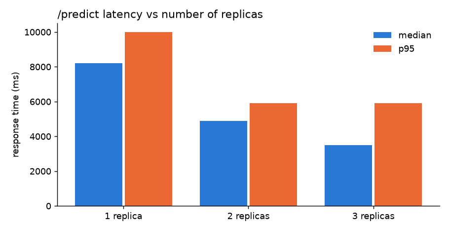

# Bean Leaf Disease Classifier — End-to-End ML Pipeline

An MLOps pipeline that diagnoses **bean leaf diseases from a phone photo**. It covers data acquisition and
preprocessing, a transfer-learning CNN, evaluation, a FastAPI service, a Streamlit dashboard, bulk data upload
with retraining triggers, Docker/cloud deployment and load testing with Locust.

| | |
|---|---|
|  **Video demo** | _YouTube link — add here_ |
| **Web app (UI)** | _https://bean-disease-ui.onrender.com_ |
| **API + Swagger docs** | _https://bean-disease-api.onrender.com/docs_ |
| **Notebook** | [notebook/bean_disease_classification.ipynb](notebook/bean_disease_classification.ipynb) |
|  **Model file** | [models/bean_disease_mobilenetv2.h5](models/bean_disease_mobilenetv2.h5) |

---

## 1. Project description

Beans are a staple food and source of income for millions of smallholder farmers in East Africa. Two leaf
diseases, **angular leaf spot** and **bean rust**, can wipe out a large share of a harvest, and farmers rarely have
quick access to an agronomist. This project lets a farmer or extension officer upload a photo of a leaf and get an
instant diagnosis with advice. The system also keeps improving: new labelled photos can be uploaded in bulk and the
model retrained from the dashboard.

**Dataset:** [iBeans](https://github.com/AI-Lab-Makerere/ibean) from the Makerere AI Lab (Uganda). It contains
1,296 smartphone field images (500×500) in 3 balanced classes: `angular_leaf_spot`, `bean_rust` and `healthy`.
1,168 images are used for train/validation and 128 are held out for testing.

**Model:** MobileNetV2 pretrained on ImageNet, with an augmentation + Dropout + L2 classification head. It is
trained in two phases (head first, then fine-tuning the top 30 layers) using Adam, EarlyStopping and
ReduceLROnPlateau. A vanilla CNN baseline is trained for comparison.

### Results (held-out test set, 128 images)

| Metric | Baseline CNN (vanilla, SGD) | **MobileNetV2 (optimised)** |
|---|---|---|
| Accuracy | 0.383 | **0.891** |
| Loss (cross-entropy) | 1.673 | **0.339** |
| Precision (macro) | 0.451 | **0.891** |
| Recall (macro) | 0.381 | **0.891** |
| F1-score (macro) | 0.257 | **0.891** |
| ROC-AUC (macro, one-vs-rest) | 0.816 | **0.964** |

Per class (F1): healthy 0.95 · angular leaf spot 0.87 · bean rust 0.85. 10 of the 14 test errors are
confusions between the two diseases.

### Data insights (3 interpreted features)

The notebook and the dashboard's **Data insights** page extract interpretable features from every image:

1. **Green leaf area.** Healthy leaves are about 70 % green-dominant pixels; diseased leaves are about 43 %.
   Disease destroys green tissue, so this feature separates *healthy vs. diseased* well.
2. **Lesion-coloured area.** Bean rust has the most brown/rust pixels (median ≈ 17 %), then angular leaf spot
   (≈ 12 %) and healthy (≈ 7 %). The ordering matches how the diseases look, but the distributions overlap.
3. **Texture (edge density).** This is nearly identical across classes (≈ 14–15 %) because field backgrounds
   dominate it.

**The story:** colour tells you *whether* a leaf is sick, but not *which* disease it has. Telling the diseases
apart needs the spatial shape of the lesions, which is why the project uses a CNN with augmentation instead of a
classic model on summary features.

---

## 2. Architecture

```
               ┌──────────────── Streamlit UI (ui/app.py) ────────────────┐
               │ Dashboard: up-time, metrics, live evaluation             │
               │ Predict · Data insights · Upload & retrain               │
               └───────────────────────────┬──────────────────────────────┘
                                           │ HTTP (requests)
┌──────────────────────────────── FastAPI (api/main.py) ─────────────────────────────────┐
│ /predict  /upload (bulk images or zip)  /retrain  /retrain/status  /model/evaluate     │
│ /health  /stats  /features  /model/metrics                                             │
├────────────────────────────────────────────────────────────────────────────────────────┤
│ src/preprocessing.py   src/model.py (build/train/evaluate/retrain)   src/prediction.py │
│ src/database.py (SQLite: uploads, training_runs, predictions)                          │
└────────────────────────────────────────────────────────────────────────────────────────┘
        data/train · data/test · data/uploads          models/*.h5 + metrics.json + archive/
```

### Retraining pipeline
1. **Upload + save to database.** `POST /upload` accepts many images with a class label, or a `.zip` with one
   folder per class. Every file is validated as an image, stored in `data/uploads/<class>/` and recorded in the
   SQLite `uploads` table.
2. **Preprocessing.** Uploaded images go through the same `load_image` pipeline as training (EXIF fix → RGB →
   160×160). They are mixed with a replay sample of the original training data to prevent catastrophic
   forgetting, and the classes are weighted.
3. **Retraining from the custom pretrained model.** The current production `bean_disease_mobilenetv2.h5` is
   loaded and fine-tuned (lr 1e-5, early stopping).
4. **Evaluation and promotion.** The new model is scored on the fixed test set and replaces the production model
   only if its accuracy doesn't drop by more than 2 points. The old model is archived in `models/archive/` and the
   API hot-reloads the new one with no downtime.

**Triggers:** the **"Retrain model now"** button (`POST /retrain`), or automatically once
`RETRAIN_THRESHOLD` (default 30) new images have been uploaded.

---

## 3. Repository structure

```
ml_pipeline_summative/
├── README.md
├── notebook/
│   └── bean_disease_classification.ipynb   # preprocessing, training, evaluation, prediction
├── src/
│   ├── config.py           # paths, classes, hyper-parameters, retrain trigger settings
│   ├── preprocessing.py    # data acquisition, preprocessing, feature extraction
│   ├── model.py            # model creation, training, evaluation, retraining
│   ├── prediction.py       # prediction functions
│   └── database.py         # SQLite persistence
├── api/main.py             # FastAPI service
├── ui/app.py               # Streamlit dashboard
├── data/
│   ├── train/<class>/      # training images
│   ├── test/<class>/       # held-out test images
│   └── image_features.csv  # extracted features for visualisations
├── models/
│   ├── bean_disease_mobilenetv2.h5
│   └── metrics.json
├── locust/locustfile.py    # load test
├── scripts/                # load-test runner + summariser
├── Dockerfile              # API image
├── Dockerfile.ui           # UI image
├── docker-compose.yml      # API replicas + nginx load balancer + UI
├── deploy/nginx.conf
└── render.yaml             # Render blueprint (cloud deployment)
```

---

## 4. Setup

### Option A — Local Python (Python 3.11)
TensorFlow 2.18 requires Python 3.9–3.12.

```bash
git clone <your-repo-url> && cd ml_pipeline_summative
python -m venv .venv
# Windows: .venv\Scripts\activate      macOS/Linux: source .venv/bin/activate
pip install -r requirements.txt

# (optional) re-download the dataset / retrain from scratch — the repo already contains data and model
python -c "from src.preprocessing import download_dataset; download_dataset()"
python -m src.model

# start the API (terminal 1)  → http://localhost:8000/docs
uvicorn api.main:app --port 8000
# start the UI (terminal 2)   → http://localhost:8501
streamlit run ui/app.py
```

### Option B — Docker
```bash
docker compose up -d --build            # API behind nginx on :8000, UI on :8501
docker compose up -d --scale api=3      # scale the API to 3 containers
docker compose restart lb               # make nginx pick up the new replicas
```

### Option C — Deploy on Render (cloud)
1. Push this repository to GitHub.
2. On [render.com](https://render.com): **New → Blueprint**, then select the repo. `render.yaml` creates two
   Docker web services: `bean-disease-api` and `bean-disease-ui`.
3. Once the API is live, open the `bean-disease-ui` service → **Environment**, set
   `API_URL=https://<your-api>.onrender.com`, and redeploy the UI.
4. Open the UI URL. The dashboard shows up-time, and **Run live evaluation** scores the production model on the
   test set inside the cloud container.

> Free-tier notes: services sleep after 15 minutes of inactivity, so the first request can take about a minute.
> The disk is ephemeral, so uploads, the SQLite database and retrained models reset when the service restarts.
> Attach a Render persistent disk to keep them. Free instances have 512 MB RAM, which is enough for prediction
> and light retraining (`REPLAY_PER_CLASS=30` keeps retraining memory low). Use the Starter plan if retraining
> gets OOM-killed.

---

## 5. Using the app
* **Predict:** *Predict* page → upload a leaf photo → class, confidence, probabilities and advice.
  API: `curl -F "file=@data/test/bean_rust/bean_rust_test.0.jpg" http://localhost:8000/predict`
* **Upload bulk data:** *Upload & retrain* → choose the class → drop many images (or a zip of class folders) →
  **Upload**.
* **Retrain:** click **Retrain model now**. You see the before/after test metrics, the loss curve and the run in
  the history table. Uploading past the threshold triggers retraining automatically.
* **Monitor:** the *Dashboard* shows model up-time, version, test metrics, prediction count/latency, and a live
  evaluation of the production model.

---

## 6. Flood request simulation (Locust)

`locust/locustfile.py` simulates farmers repeatedly posting real test images to `/predict` (plus `/health`
checks). The same flood was run against the API with different numbers of replicas.

```bash
bash scripts/run_load_tests.sh 50 60s      # 50 users, 60 s, for 1, 2 and 3 containers
# or interactively:
locust -f locust/locustfile.py --host http://localhost:8000   # → http://localhost:8089
```

### Results — 30 concurrent users, 60 s per run, `/predict` endpoint

| Replicas | Requests | Failures | Avg (ms) | Median (ms) | p95 (ms) | p99 (ms) | Throughput (req/s) |
|---:|---:|---:|---:|---:|---:|---:|---:|
| 1 | 167 | 0 | 8,264 | 8,200 | 10,000 | 10,000 | 2.88 |
| 2 | 274 | 0 | 4,879 | 4,900 | 5,900 | 6,900 | 4.56 |
| 3 | 361 | 0 | 3,660 | 3,500 | 5,900 | 8,000 | 5.97 |



**Interpretation.** A single prediction takes about 300 ms when the server is idle. Under a flood of 30
concurrent users, one replica saturates and requests queue, so the median response time grows to about 8 s.
Adding replicas spreads the queue: going from 1 to 3 replicas **doubles throughput (2.9 → 6.0 req/s) and cuts
median latency by 57 % (8.2 s → 3.5 s)**, with zero failed requests. Gains shrink after 2 replicas because the
test machine has only 2 physical CPU cores, which all replicas and the Locust client share. On a cloud host with
one CPU per container, scaling would stay closer to linear.

> These numbers were measured locally on an Intel i5-7200U (2 cores / 4 threads, 8 GB RAM), with each replica
> running as an independent uvicorn worker process holding its own copy of the model
> (`python scripts/run_load_tests_local.py 30 60s`). To repeat the test with real Docker containers behind the
> nginx load balancer, run `bash scripts/run_load_tests.sh 30 60s`. Raw Locust CSVs are in `locust/results/`.
